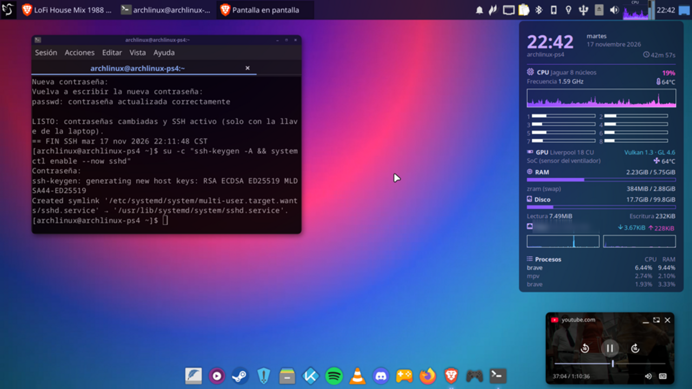

# 🎮 PS4 Linux Gamer

**Arch Linux en una PS4 Slim como PC gamer y centro multimedia**: Steam, emuladores (PS1, N64, Dreamcast, PSP, GameCube…), Kodi con TV por internet, YouTube, Spotify y un escritorio bonito que se maneja con el control.



Probado en una **PS4 Slim CUH-2115B (southbridge Baikal), firmware 13.02 con GoldHEN**, usando [ps4-multiboot](https://github.com/blue0x1/ps4-multiboot) v1.5.0-beta.5 (kernel 7.3.3-Strawberry) y su `ps4-mesa`. Todo se instala en una imagen dentro del disco interno: **el sistema de la PS4 no se toca** y se sigue usando normal.

> ⚠️ Haces esto bajo tu propio riesgo. Este repositorio **no incluye** payloads, kernels, BIOS, juegos ni ROMs: descárgalos de sus proyectos oficiales y usa solo copias de juegos que tengas.

---

## Índice

1. [Qué vas a obtener](#1-qué-vas-a-obtener)
2. [Requisitos](#2-requisitos)
3. [GoldHEN y Payload Guest](#3-goldhen-y-payload-guest)
4. [Instalar Arch con ps4-multiboot](#4-instalar-arch-con-ps4-multiboot)
5. [Instalación automática (setup-arch.sh)](#5-instalación-automática-setup-archsh)
6. [SSH con llave](#6-ssh-con-llave)
7. [Escritorio](#7-escritorio)
8. [Control DualShock 4](#8-control-dualshock-4)
9. [Emuladores](#9-emuladores)
10. [Multimedia: Kodi, TV por internet, YouTube](#10-multimedia-kodi-tv-por-internet-youtube)
11. [Extras: reposo, ventilador, firewall, rendimiento](#11-extras-reposo-ventilador-firewall-rendimiento)
12. [Clonar el sistema a otra PS4](#12-clonar-el-sistema-a-otra-ps4)
13. [Problemas y soluciones](#13-problemas-y-soluciones)
14. [Rendimiento](#14-rendimiento)
15. [Créditos](#15-créditos)

---

## 1. Qué vas a obtener

- **Arranque directo al escritorio** (LXQt + Openbox) con tema oscuro, fondo animado, dock (Plank), efectos (picom) y un widget de monitor (CPU, GPU, temperaturas, RAM, red).
- **Juegos**: Steam (con GE-Proton y ntsync), Heroic, Lutris, `gamescope` con **FSR**, MangoHud y GameMode.
- **Emuladores** con **EmulationStation-DE** como menú: RetroArch (SNES, GBA, NES, Mega Drive, PS1, N64, Dreamcast, Neo Geo), Dolphin, PPSSPP.
- **Control como mouse** en el escritorio, que se pausa solo al jugar. Luz del control en morado.
- **Kodi** con TV por internet legal (listas de iptv-org revisadas cada semana) y modo **ventana mini** sobre el escritorio.
- **Brave** con video flotante, mini reproductor de YouTube (`Super+Y`), Spotify, Discord, KDE Connect, Moonlight.
- **Modo reposo ligero** (la PS4 no puede suspender en Linux), ventilador más fresco, firewall solo-red-local.
- Todo administrable por **SSH desde tu PC**.

## 2. Requisitos

| | |
|---|---|
| Consola | PS4 Slim/Fat con firmware compatible con **GoldHEN** (probado en 13.02; los payloads de Linux soportan de 5.05 a 13.02) |
| Espacio | **64 GB libres** como mínimo en el disco de la PS4 (recomendado 100 GB o más) |
| PC | Cualquier PC en la **misma red** (Linux/macOS; en Windows usa WSL) con `python3`, `curl` y `ssh` |
| Red | Cable de red recomendado durante la instalación |
| Control | DualShock 4 + cable USB (para emparejarlo la primera vez) |
| Opcional | Teclado y mouse USB (para la instalación es más cómodo) |

Clona este repositorio en tu PC y descarga de [ps4-multiboot](https://github.com/blue0x1/ps4-multiboot/releases) el payload `linux-2048mb.bin`, `bzImage`, `initramfs.cpio.gz`, `bootargs.txt`, `ps4-mesa.tar.xz` y la imagen base de Arch.

## 3. GoldHEN y Payload Guest

1. Activa **GoldHEN** en tu PS4 con el método de tu firmware.
2. En el menú de GoldHEN activa **FTP Server** y **BinLoader Server**.
3. Instala **Payload Guest** (v0.98) para lanzar Linux desde la pantalla de inicio (sin entrar a menús):
   ```bash
   PS4_IP=192.168.1.50 bash scripts/subir-payloadguest.sh   # sube el .pkg por FTP
   ```
   y en la PS4: **GoldHEN → Package Installer → Payload Guest**.
4. Sube los archivos de Linux por FTP (puerto 2121): `bzImage`, `initramfs.cpio.gz`, `bootargs.txt` a `/data/linux/boot/`, el payload a `/data/payloads/` y las imágenes a `/user/home/`. (`scripts/instalar-otra-ps4.sh` hace exactamente esto.)

> Alternativa sin Payload Guest: `PS4_IP=… bash scripts/arrancar-linux.sh` envía el payload al BinLoader (puerto 9090).

## 4. Instalar Arch con ps4-multiboot

En la PS4: **Payload Guest → linux-2048mb.bin** → menú de ps4-multiboot → **archlinux → Install to PS4** → elige el tamaño del disco (**64 GB mínimo**).

- Crear el disco tarda (≈1 h por cada 100 GB): es normal. No apagues la consola.
- Al terminar: **Boot**. El usuario por defecto es `archlinux` / contraseña `archlinux` (la cambiamos en el paso 6).

## 5. Instalación automática (`setup-arch.sh`)

En tu PC, dentro de la carpeta del repo, deja corriendo el servidor que entrega los scripts y recibe los registros:

```bash
cp scripts/*.sh scripts/serve.py ./ ; cp /ruta/a/ps4-mesa.tar.xz ./   # opcional: ps4-mesa local
python3 serve.py            # escucha en el puerto 8000
```

En la PS4 (terminal o consola de texto), como root:

```bash
su -c "curl -s IP_DE_TU_PC:8000/s | HOST=IP_DE_TU_PC:8000 bash"
```

El script ([scripts/setup-arch.sh](scripts/setup-arch.sh)) hace, sin preguntar nada:

| Paso | Qué hace |
|---|---|
| 1 | Hora, zona horaria (`America/Mexico_City`), idioma `es_MX` — cámbialos al inicio del script. Repara el DNS si viene roto |
| 2 | Mirrors rápidos, `multilib`, llaves y **`DisableSandbox`** en pacman (el kernel de PS4 no tiene Landlock) |
| 3 | Actualiza todo el sistema |
| 4 | `sudo`, herramientas, grupos del usuario, fuente grande para la consola |
| 5 | LXQt, SDDM, NetworkManager (Wi-Fi sin MAC aleatoria), PipeWire, Bluetooth, fuentes |
| 6 | Mesa/Vulkan, Steam, gamescope, MangoHud, GameMode, Lutris, Wine |
| 6b | Kodi, VLC, códecs, yt-dlp, Spotify |
| 7 | RetroArch + núcleos, Dolphin, PPSSPP |
| 8 | `yay` (AUR), Heroic, ProtonUp-Qt, reglas de mandos, **EmulationStation-DE** (se compila: 30-60 min) |
| 9 | **ps4-mesa** (drivers 3D de la GPU Liverpool) — se re-aplica tras instalar el Mesa del sistema |
| 10 | zram (RAM comprimida), governor `performance`, GameMode |
| 11 | Autologin, tema oscuro, corrección de overscan para TV, accesos directos |
| 11b | Fondo animado (mpv + xwinwrap), picom con animaciones, Plank, menú rofi a pantalla completa (tecla Super) |
| 12 | Diagnóstico (GPU, Vulkan, Bluetooth, mandos) |

Cada paso sube el registro a tu PC (`logs/`), así puedes seguirlo sin estar frente a la TV. Al terminar: `reboot` → **Boot** en el menú.

## 6. SSH con llave

Genera una llave en tu PC y ponla junto a `serve.py` como `laptop.pub`:

```bash
ssh-keygen -t ed25519 -f ~/.ssh/ps4_ed25519
cp ~/.ssh/ps4_ed25519.pub laptop.pub
```

En la PS4, como root: `su -c "curl -s IP_DE_TU_PC:8000/ssh.sh | bash"`. Instala OpenSSH + Avahi (`archlinux-ps4.local`), **solo permite entrar con esa llave** (sin contraseñas por red) y te pide **cambiar las contraseñas** de `archlinux` y `root`.

En tu PC, `~/.ssh/config`:

```
Host ps4
    HostName archlinux-ps4.local      # o la IP de la PS4
    User archlinux
    IdentityFile ~/.ssh/ps4_ed25519
Host ps4root
    HostName archlinux-ps4.local
    User root
    IdentityFile ~/.ssh/ps4_ed25519
```

Desde aquí todo se puede hacer por SSH. Para abrir programas gráficos por SSH usa [`en-sesion`](configs/bin/en-sesion) (copia el entorno de la sesión): `ssh ps4 '~/.local/bin/en-sesion kodi'`. Para ver la pantalla de la PS4 desde tu PC: `scripts/ps4cap.sh captura.png`.

## 7. Escritorio

Ejecuta en la PS4 (sesión gráfica, usuario `archlinux`):

```bash
curl -s IP_DE_TU_PC:8000/escritorio.sh | bash   # tema, fondo, dock, panel, widget, control BT
curl -s IP_DE_TU_PC:8000/mejoras.sh | bash      # Brave, gráfica de CPU junto a la hora, capturas, pantalla siempre encendida, letras grandes, modo consola
curl -s IP_DE_TU_PC:8000/dock.sh | bash         # barra arriba, dock abajo sin encimarse
curl -s IP_DE_TU_PC:8000/ytmini.sh | bash       # Super+Y = mini reproductor flotante de YouTube
```

- **Fondo animado v2**: [`fondo-v2.sh`](scripts/fondo-v2.sh) genera con ffmpeg un video de 150 s con 5 escenas (degradados radiales, en espiral, patrones de autómatas) y transiciones, en bucle perfecto. El fondo **se pausa solo** con juegos o ventanas a pantalla completa.
- **Modo consola**: accesos para usar todo con el control (ES-DE, Steam Big Picture, Kodi).
- **Arranque y cierre de sesión sin contraseña**: [`configs/sddm.conf`](configs/sddm.conf) (`Relogin=true`: si cierras sesión vuelve a entrar sola).

## 8. Control DualShock 4

**Emparejar**: en Linux de la PS4 el DS4 solo se empareja bien **por cable** (BlueZ `sixaxis`):

```bash
curl -s IP_DE_TU_PC:8000/control.sh | bash
```
Conecta el control por USB cuando lo pida, desconéctalo y presiona **PS**. A partir de ahí se conecta solo.

**Control como mouse** — [`mando-mouse.py`](scripts/mando-mouse.py) (servicio de usuario):
| Control | Acción |
|---|---|
| Stick izq. | Mover el puntero (R2 = rápido, L2 = preciso) |
| Stick der. | Scroll |
| ✕ / ◯ / ▢ | Clic izquierdo / derecho / central |
| △ | Menú de apps (tecla Super) |
| Cruceta | Flechas |
| L1 / R1 | Pestaña anterior / siguiente |
| Share / Options | Esc / Enter |
| L3 / R3 | Atrás (Alt+←) / pantalla completa (F11) |
| **PS** | Activar / desactivar el modo mouse |
| **Share + Options** | Con Kodi abierto: alternar ventana mini |

Se **pausa solo** cuando hay un juego, emulador, Steam o Kodi a pantalla completa abierto (ellos manejan el control).

**Luz morada**: [`configs/udev/70-ds4-morado.rules`](configs/udev/70-ds4-morado.rules).

## 9. Emuladores

- **EmulationStation-DE** es el menú (`~/ROMs/<sistema>`). Copia tus ROMs por SFTP (`sftp://ps4/home/archlinux/ROMs` en el gestor de archivos de tu PC).
- **PS1** con **PCSX ReARMed** (AUR `libretro-pcsx-rearmed-git`, compilado en la PS4): **60 FPS** estables. En ES-DE: `alternativeEmulator` = *PCSX ReARMed*.
- **N64** (Mupen64Plus-Next) y **Dreamcast** (Flycast a 2× = 1280×960) van bien; **PSP** (PPSSPP) también; **Neo Geo** con *MAME - Current*.
- 👉 **El ajuste más importante**: en RetroArch `input_driver = "x"`. Con `udev` (el predeterminado) los juegos van a ~30 FPS. Detalles en [configs/retroarch-ajustes.md](configs/retroarch-ajustes.md).
- BIOS: ponlas en `~/.config/retroarch/system/` (no se incluyen).

## 10. Multimedia: Kodi, TV por internet, YouTube

- **Kodi** + `kodi-addon-pvr-iptvsimple` (AUR) con listas **legales** de [iptv-org](https://github.com/iptv-org/iptv).
- [`tv-filtrar.sh`](scripts/tv-filtrar.sh) descarga las listas (México y en español), **prueba cada canal** y guarda solo los que funcionan. Un temporizador lo repite cada domingo: [`configs/systemd/tv-filtrar.*`](configs/systemd/). En nuestras pruebas: ~110 de 176 canales de México y ~1 400 de 2 400 en español.
- Ajustes de Kodi para que la TV sea fluida: sin guía al cambiar de canal (`pvrplayback.confirmchannelswitch=false`, `displaychannelinfo=0`) y guía actualizada solo cada 12 h.
- **Kodi en ventana mini**: [`kodi-pip`](scripts/kodi-pip) (Super+K o Share+Options) alterna entre pantalla completa y una ventana pequeña siempre encima.
- **Compartir videos/música de tu PC** con Kodi: `scripts/compartir-medios.sh`.

## 11. Extras: reposo, ventilador, firewall, rendimiento

| Qué | Archivo | Notas |
|---|---|---|
| **Reposo ligero** | [`configs/bin/reposo`](configs/bin/reposo) | La PS4 **no puede suspender** en Linux. Esto apaga la pantalla, baja CPU y ventilador y pausa el fondo; despierta con el control |
| Permisos del reposo | [`configs/sudoers-zz-reposo`](configs/sudoers-zz-reposo) | Debe llamarse `zz-…` para leerse **después** de `wheel` |
| **Ventilador** | [`configs/bin/ps4-ventilador`](configs/bin/ps4-ventilador) + [servicio](configs/systemd/ps4-ventilador.service) | Acelera desde 65 °C en vez de 75 °C |
| **Firewall** | [`configs/nftables.conf`](configs/nftables.conf) | Solo la red local entra (SSH, KDE Connect, Steam) |
| **ntsync** | [`configs/udev/60-ntsync.rules`](configs/udev/60-ntsync.rules) + `PROTON_USE_NTSYNC=1` en `/etc/environment` | Mejor rendimiento en juegos de Windows |
| **FSR** | [`configs/bin/fsr`](configs/bin/fsr) | En Steam: `fsr %command%` → 720p escalado a 1080p |
| Servicios | — | Desactivados: `systemd-homed`, `NetworkManager-wait-online`, `ModemManager`; journal limitado a 150 MB → arranque más rápido |

## 12. Clonar el sistema a otra PS4

Con todo configurado, empaqueta el sistema **sin ROMs ni datos personales**. Desde tu PC (lo empaqueta la PS4 y lo guarda directo en tu PC):

```bash
ssh ps4root 'cd / && tar --one-file-system --numeric-owner --xattrs --acls -cpf - \
  --exclude=./proc --exclude=./sys --exclude=./dev --exclude=./run --exclude=./tmp --exclude=./mnt --exclude=./media --exclude=./lost+found \
  --exclude="./home/archlinux/ROMs/*/*" --exclude=./home/archlinux/ES-DE/downloaded_media \
  --exclude="./home/archlinux/.cache/*" --exclude="./var/cache/pacman/pkg/*" --exclude="./var/log/journal/*" \
  --exclude=./etc/machine-id --exclude="./etc/ssh/ssh_host_*" --exclude=./var/lib/bluetooth --exclude=./swapfile \
  . | nice -n 10 xz -T8 -6 -c' > ps4gamer-ps4-rootfs.tar.xz
xz -t ps4gamer-ps4-rootfs.tar.xz && echo "INTEGRIDAD OK"
```
Quedan las carpetas de ROMs vacías (listas para llenar), sin llaves SSH, sin identidad de máquina ni controles emparejados. En nuestro caso: **5.3 GB**.

- Instala [`primer-arranque.service`](configs/systemd/primer-arranque.service) antes de empaquetar: cada PS4 nueva genera sus propias llaves SSH.
- El nombre del archivo debe ser `<nombre>-ps4-rootfs.tar.xz`: ps4-multiboot lo muestra en su menú como `<nombre>`.
- En la otra PS4 (GoldHEN con FTP): `bash scripts/instalar-otra-ps4.sh IP_DE_LA_OTRA_PS4` sube todo y verifica tamaños. Luego Payload Guest → linux-2048mb.bin → **ps4gamer → Install to PS4**.

## 13. Problemas y soluciones

| Síntoma | Causa | Solución |
|---|---|---|
| `pacman` falla al descargar | El kernel no tiene **Landlock** (sandbox de pacman 7) | `DisableSandbox` en `/etc/pacman.conf` |
| Sin internet tras reiniciar | `resolv.conf` apuntando a `systemd-resolved` apagado | Que NetworkManager lo escriba (paso 1 del script) |
| El script se "come" sus propias líneas al correr con `curl … \| bash` | `ffmpeg` lee stdin | `ffmpeg -nostdin … </dev/null` |
| Fondo negro / el dock desaparece | `xwinwrap` usa `%WID`, y con `-ov` tapa el dock | `mpv -wid %WID` y `xwinwrap -fdt` |
| El fondo animado falla al iniciar sesión | mpv con Vulkan antes de que la GPU esté lista | `--vo=gpu --gpu-api=opengl` + 5 s de espera + reintentos |
| Gráfica de CPU del panel no aparece | Falta `libsysstat` | `pacman -S libsysstat` |
| El control dice "emparejado" pero no conecta | El DS4 no se empareja por Bluetooth directo | Emparejar **por cable** (`control.sh`) y presionar PS |
| Juegos de RetroArch a 25-39 FPS | `input_driver udev` llama a `XGetInputFocus` en cada lectura | `input_driver = "x"` |
| Los sticks no responden en PS1 | El tipo de mando se lee del remap | `input_libretro_device_p1 = "517"` en el `.rmp` |
| Los ajustes de RetroArch "se pierden" | RetroArch reescribe la config al salir | Editar solo con RetroArch cerrado |
| Una regla `NOPASSWD` de sudo no funciona | Los archivos de `sudoers.d` se leen en orden y gana la última | Nombrarla `zz-…` |
| SSH no arranca en una imagen nueva | La imagen no trae llaves de host | `ssh-keygen -A` (o `primer-arranque.service`) |
| "Suspender" cierra la sesión y pide contraseña | El kernel de PS4 no soporta suspensión | Usar `reposo` + `Relogin=true` en SDDM |
| `pkill -f patrón` por SSH te desconecta | El patrón aparece en tu propio comando | Truco de corchetes: `pkill -f "[k]odi"` |
| La ventana mini de Kodi pierde su tamaño | Kodi **recrea su ventana** al salir de pantalla completa | Buscar la ventana de nuevo en cada paso (`kodi-pip`) |

## 14. Rendimiento

| | |
|---|---|
| CPU | AMD Jaguar, 8 núcleos @ 1.6 GHz — 7-Zip: **~13 000 MIPS** |
| GPU | AMD Liverpool 18 CU (radeonsi/RADV) — **OpenGL 4.6, Vulkan 1.3** |
| RAM disponible | ~5.7 GB + zram |
| PS1 / N64 / Neo Geo / PSP | 60 FPS |
| Dreamcast | 60 FPS a 2× de resolución |

## 15. Créditos

- [ps4-multiboot](https://github.com/blue0x1/ps4-multiboot) y `ps4-mesa` — el trabajo duro de arrancar Linux con aceleración 3D en la PS4.
- Kernel PS4 "Strawberry", [GoldHEN](https://github.com/GoldHEN/GoldHEN), Payload Guest, [PS4 Linux payloads](https://github.com/ArabPixel/ps4-linux-payloads).
- [iptv-org](https://github.com/iptv-org/iptv) por las listas públicas de TV.
- Arch Linux, LXQt, RetroArch, EmulationStation-DE, Kodi y todos sus autores.

Configuración armada paso a paso con ayuda de Claude (Anthropic).
